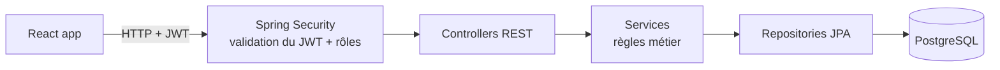

# LeaveManager — API


API REST de gestion des congés : **un employé pose une demande, son manager la valide ou la refuse**, et le solde de congés est mis à jour automatiquement.

> Frontend React : [leavemanager-web](https://github.com/<ton-compte>/leavemanager-web)

## Stack

| Domaine | Technologies |
|---|---|
| Langage | Java 25 |
| Framework | Spring Boot 4 (Web MVC, Data JPA, Security, Validation) |
| Sécurité | JWT signé HS256 (Spring OAuth2 Resource Server), mots de passe BCrypt, rôles `EMPLOYEE` / `MANAGER` |
| Base de données | PostgreSQL, migrations versionnées avec Flyway |
| Documentation | OpenAPI / Swagger UI |
| Tests | JUnit 5, AssertJ, MockMvc, H2 en mémoire |
| DevOps | Docker (build multi-stage), Docker Compose, GitHub Actions |

## Architecture



Le code est organisé **par fonctionnalité**, pas par couche technique :

```
src/main/java/com/leavemanager/api/
├── auth/      inscription, connexion, génération du JWT
├── user/      entité User, profil (/api/profile)
├── leave/     demandes de congés : entité, workflow, service, controllers
├── config/    sécurité, Swagger, données de démo
└── common/    gestion centralisée des erreurs
```

## Règles métier

- Une demande suit le cycle `PENDING` → `APPROVED` | `REJECTED` | `CANCELLED`.
- Seule une demande `PENDING` peut être validée, refusée ou annulée.
- Le nombre de jours est calculé en **jours ouvrés** (du lundi au vendredi).
- Un employé ne peut pas avoir deux demandes actives qui se chevauchent.
- Un congé payé (`PAID`) est refusé si le solde est insuffisant ; il est débité au moment de la validation.
- Un manager ne peut pas valider sa propre demande.
- Les comptes de démo ont un profil en lecture seule, pour qu'un visiteur ne puisse pas bloquer les suivants en changeant le mot de passe.

Les transitions d'état sont codées dans l'entité `LeaveRequest` elle-même, ce qui empêche de contourner les règles.

## Endpoints

| Méthode | URL | Rôle | Description |
|---|---|---|---|
| POST | `/api/auth/register` | public | Créer un compte employé |
| POST | `/api/auth/login` | public | Se connecter, renvoie un JWT |
| GET | `/api/profile` | connecté | Mon profil et mon solde |
| PUT | `/api/profile` | connecté | Modifier mon nom et mon email |
| PUT | `/api/profile/password` | connecté | Changer mon mot de passe (l'actuel est exigé), renvoie un nouveau JWT |
| GET | `/api/leaves/me` | connecté | Mes demandes |
| POST | `/api/leaves` | connecté | Poser une demande |
| PATCH | `/api/leaves/{id}/cancel` | connecté | Annuler ma demande |
| GET | `/api/manager/leaves?status=PENDING` | MANAGER | Toutes les demandes |
| PATCH | `/api/manager/leaves/{id}/approve` | MANAGER | Valider |
| PATCH | `/api/manager/leaves/{id}/reject` | MANAGER | Refuser |

La documentation interactive est disponible sur **`/swagger-ui.html`**.

## Sécurité

| Menace | Protection |
|---|---|
| Vol de mots de passe en base | Hachage **BCrypt** ; les mots de passe ne sont jamais renvoyés. Longueur vérifiée en octets, car BCrypt ignore tout ce qui dépasse 72 octets |
| Brute force sur la connexion | Après **5 échecs** pour un même email depuis une même IP, la connexion est bloquée **15 minutes** (429). L'IP réelle est lue derrière le proxy d'hébergement (`server.forward-headers-strategy=native`) |
| Énumération des comptes | Message identique pour un email inconnu et un mauvais mot de passe |
| Falsification de token | JWT signé en HS256, avec vérification de la signature, de l'expiration et de l'**émetteur** (`iss`) |
| Secret JWT par défaut en production | Avec le profil `prod`, l'application **refuse de démarrer** si `JWT_SECRET` est absent ou fait moins de 32 octets (`JwtSecretPolicy`) |
| Token volé | Durée de vie limitée. Changer de mot de passe **révoque tous les tokens existants** grâce à une version de session stockée en base et dans le token |
| Accès aux données d'un autre utilisateur (IDOR) | L'identifiant de l'utilisateur vient toujours du JWT, jamais de la requête ; la propriété d'une demande est vérifiée avant de l'annuler |
| Élévation de privilèges | Rôles vérifiés côté serveur (`/api/manager/**` réservé à `ROLE_MANAGER`) ; l'inscription crée toujours un `EMPLOYEE` |
| Assignation de champs non prévus | DTO dédiés en entrée et en sortie, validés avec Bean Validation ; les entités ne sont jamais exposées |
| CSRF | Sans objet : authentification par en-tête `Authorization`, sans cookie |
| CORS | Une seule origine autorisée (`CORS_ALLOWED_ORIGINS`) |
| Surface d'attaque | Seul `/actuator/health` est exposé, conteneur Docker sans root, secrets uniquement en variables d'environnement |
| Dépendances vulnérables | **Dependabot** propose chaque semaine les mises à jour Maven et GitHub Actions ([.github/dependabot.yml](.github/dependabot.yml)) |

Ces protections sont vérifiées par `SecurityIntegrationTest`, `ProfileIntegrationTest`, `LoginAttemptServiceTest` et `JwtSecretPolicyTest`.

## Lancer le projet en local

Prérequis : JDK 25 et Docker.

```bash
# 1. Démarrer PostgreSQL
docker compose up -d db

# 2. Démarrer l'API (http://localhost:8080)
./mvnw spring-boot:run
```

Ou tout en conteneurs : `docker compose up --build`.

### Comptes de démo

Créés automatiquement au premier démarrage (mot de passe `Demo1234!`) :

| Rôle | Email |
|---|---|
| Manager | `manager@demo.com` |
| Employé | `employee@demo.com` |

## Tests

```bash
./mvnw verify
```

- **Tests unitaires** (`LeaveRequestTest`, `WorkingDaysTest`) : règles métier pures, sans Spring ni base de données.
- **Tests unitaires de sécurité** (`LoginAttemptServiceTest`, `JwtSecretPolicyTest`) : blocage après plusieurs échecs, refus du secret par défaut en production.
- **Tests d'intégration** (`LeaveWorkflowIntegrationTest`, `ProfileIntegrationTest`, `SecurityIntegrationTest`) : vraie application Spring, vraie sécurité, base H2 en mémoire. Ils couvrent le parcours complet (inscription, demande, validation, solde, profil) ainsi que les attaques et cas d'erreur (401, 403, 409, 429, 400).

## CI/CD

- **CI** ([.github/workflows/ci.yml](.github/workflows/ci.yml)) : à chaque push ou pull request sur `main`, compilation, tests, puis build de l'image Docker.
- **CD** : Render déploie automatiquement l'image Docker une fois la CI au vert. La base PostgreSQL est hébergée sur Neon.

Variables d'environnement à définir en production : voir [.env.example](.env.example). En particulier, `SPRING_PROFILES_ACTIVE=prod` et un `JWT_SECRET` aléatoire, que l'on peut générer avec :

```bash
openssl rand -base64 48
```

## Pistes d'amélioration

- Prise en compte des jours fériés
- Rattachement de chaque employé à son propre manager
- Notifications par email
- Pagination des listes
